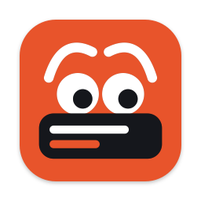
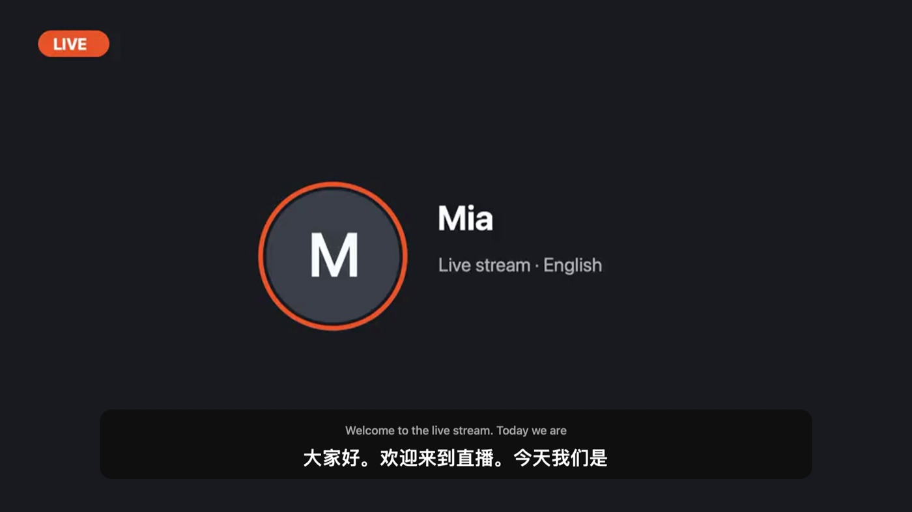
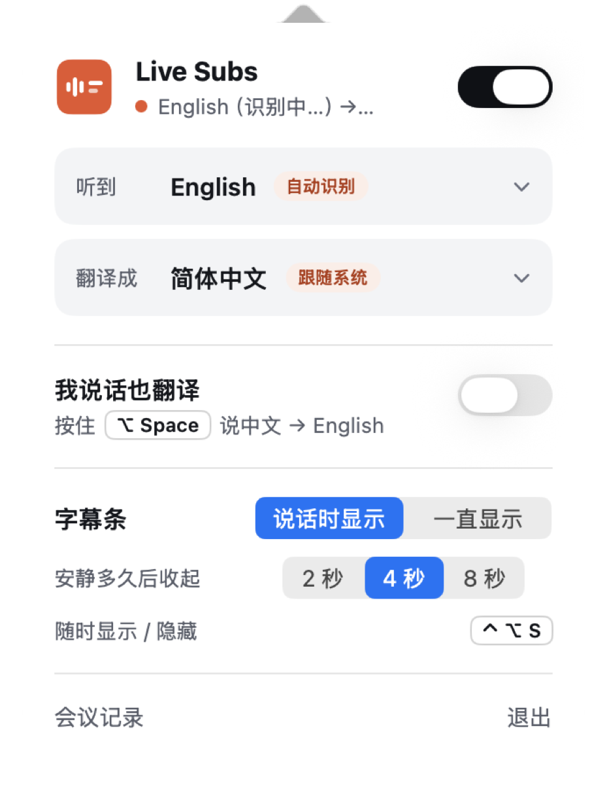
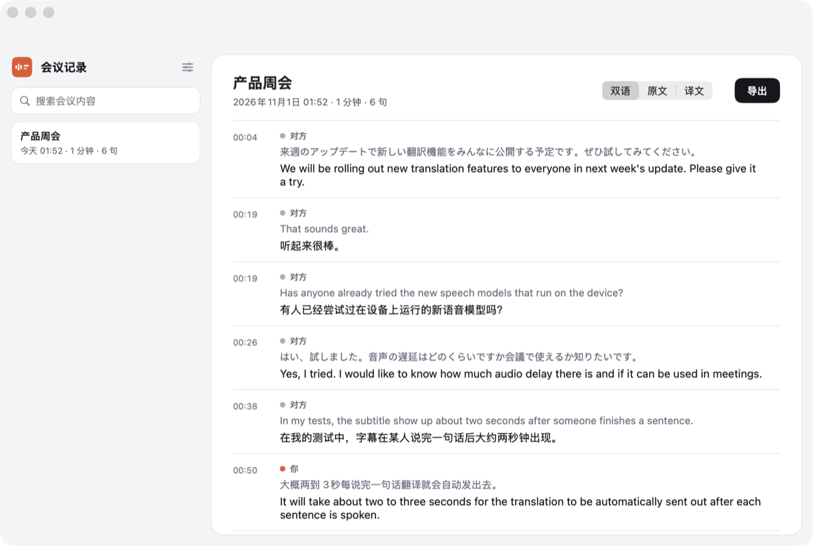
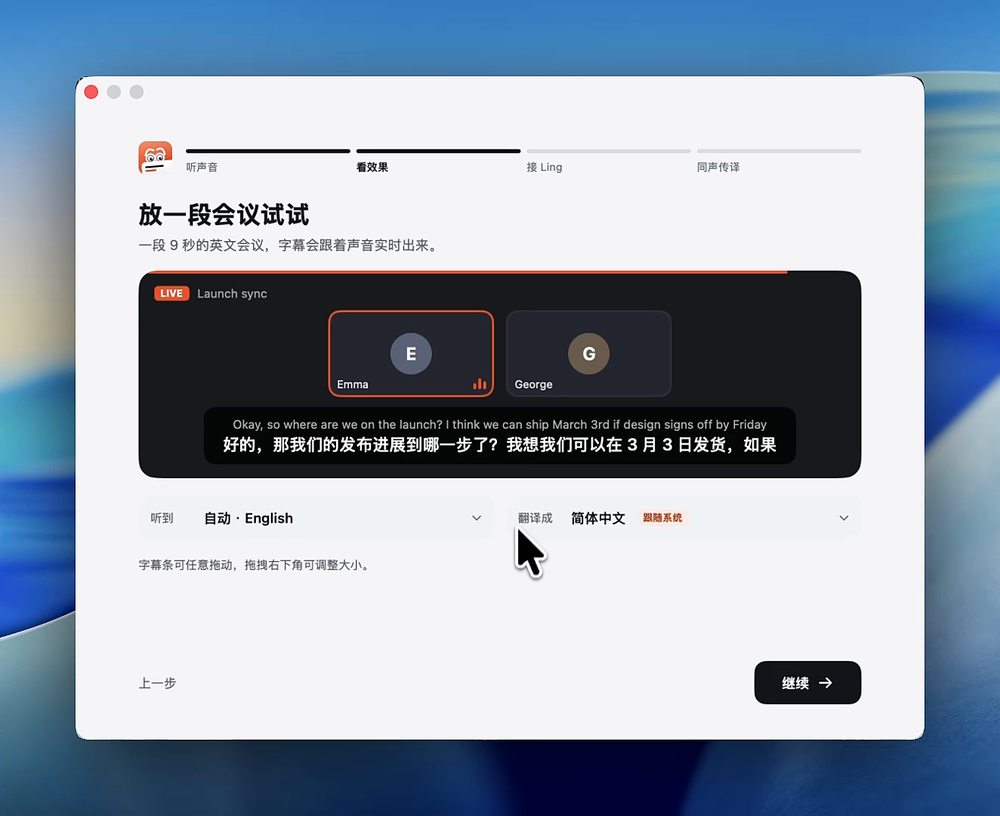

<p align="center">
  
</p>

<h1 align="center">Cicada · 知了</h1>

<p align="center">
  Every call. Every stream. No language barrier.<br>
  Live subtitles, interpreting and meeting notes for anything your Mac plays.
</p>

<p align="center">
  <a href="https://github.com/wquguru/cicada/releases/latest"><b>Download for macOS</b></a> · <a href="CHANGELOG.md"><b>What’s new</b></a>
</p>

<p align="center">
  
  
  
  
</p>

<p align="center">
  
</p>

<p align="center"><a href="README.md">English</a> · <a href="README.zh-CN.md">简体中文</a></p>

---

Cicada (知了, “cicada” in Chinese, formerly Live Subs) listens to what your Mac is playing — a livestream, a video, a meeting, a voice room — works out which language is being spoken, and shows the translation in a small subtitle bar on top of everything. Recognition happens on your Mac; only the recognised text is sent for translation.

## Features

- **Detects the language for you** — every installed on-device speech model listens to the same few seconds; the most confident one wins, usually within half a second.
- **Translates into your language** — follows your system languages by default (English audio on an English Mac goes to your next language), or pick one.
- **Stays out of the way** — the subtitle bar appears only while someone talks, tucks into a small dot when it's quiet, and turns see-through when your pointer passes over it, so you can still click what's underneath. Rest the pointer on it to drag or resize; ⌃⌥S hides it.
- **Live meeting notes** — with your own [Ling](https://chat.ant-ling.com/open) API key (Settings › AI 服务, kept only on your Mac in a file only your account can read), a floating notes window fills in while the meeting runs: a summary, topics with key points, a fishbone diagram where causes are discussed, conclusions and to-dos, and names spelled consistently. Drag it anywhere, shrink it to a card (it tells you when something new was said since) or widen it to read notes beside the transcript; it never shows up when you share your screen. While it is open the app's menus are in the top left (stop recording ⌘R, what was added since collapsing ⌘J, search ⌘F, sizes ⌘1–⌘3). A full version is written when the meeting ends. The same key makes translation more accurate and lets the room hear a natural Ming voice, or your own voice cloned from a 15 s recording (Settings › 同声传译); without a key everything else works as before.
- **Speak back** — hold the right ⌥ key and talk; the room hears your words translated, through a virtual microphone you install from the app. With a Ling key, Ming's audio model hears and translates what you said in one step, so names come out right.
- **Meeting records** — every session is saved as a bilingual transcript (with the audio, on your Mac only) and exports to Markdown, Word or SRT.
- **Private by design** — audio capture, language detection and speech recognition all run on-device. The only audio that leaves your Mac is what you say while holding the talk key, and only with a Ling key.

<p align="center">
  
  &nbsp;
  
</p>

<p align="center">
  
</p>

## Requirements

- macOS 26 on Apple silicon
- Building from source: Xcode Command Line Tools (`xcode-select --install`)

## Installation

Download **`Cicada-<version>-macOS-AppleSilicon.dmg`** from [Releases](https://github.com/wquguru/cicada/releases), open it and drag **Cicada** into **Applications**. A `.zip` of the app and `checksums.txt` (SHA-256) sit next to it.

The app is ad-hoc signed (not notarized). On first launch macOS blocks it: open **System Settings › Privacy & Security** and click **Open Anyway**.

The first launch walks you through three steps: turn on **system audio recording** (and, optionally, the microphone), play the built-in sample to see subtitles appear, and — if you want to speak back — install the virtual microphone with one click (it asks for your password once); a quick sound test then confirms the room will hear you.

## Usage

1. Play anything with sound. The live notes window shows the transcript and a caption line (choose 字幕条 in the panel for the classic subtitle bar; ⌃⌥S cycles notes / bar / nothing).
2. Click the menu bar icon to change the heard language (auto by default), the language to translate into, or what is shown.
3. For notes: paste a Ling API key in Settings › AI 服务 (or right in the notes window). About ¥0.15–1 per hour of meeting at current prices; only text is sent, speech recognition stays on your Mac.
4. To speak back: turn on **同声传译**, choose **BlackHole 2ch** as the microphone in your meeting app, then hold the right ⌥ key while you talk (allow "Input Monitoring" when asked). Both shortcuts can be changed in settings.
5. **会议记录** in the panel opens your meetings: notes and transcript, search, export (Markdown and Word start with the notes). A meeting recorded without notes has a "生成纪要" button.

### Uninstall

Quit Cicada and move it to the Trash. Transcripts and recordings stay in `~/Library/Application Support/LiveSubs` until you delete them; settings are in `defaults delete com.wquguru.cicada`.

## Development

```bash
scripts/build.sh            # dev build → build/Cicada.app ("Cicada Dev", runs beside the installed app)
open build/Cicada.app
scripts/package.sh          # release DMG + zip + checksums
```

See [AGENTS.md](AGENTS.md) for the architecture, dev vs release builds, packaging, testing and releases.

The website (`site/`, published to GitHub Pages) is built by `scripts/site.py`; see AGENTS.md.

## License

[Apache-2.0](LICENSE). The virtual microphone, BlackHole, is GPL-licensed and is downloaded from its official release when you install it; it is not bundled.
