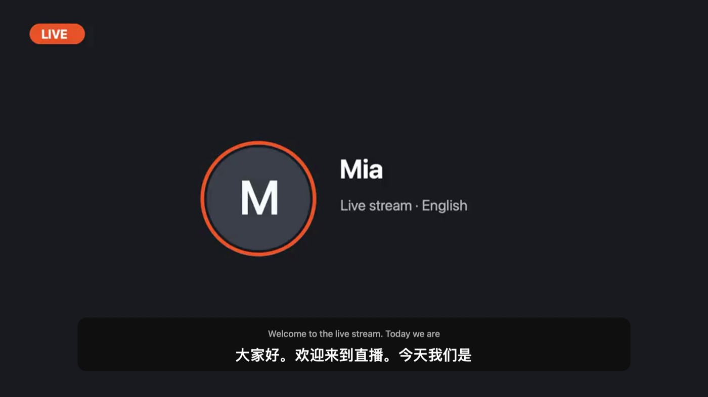
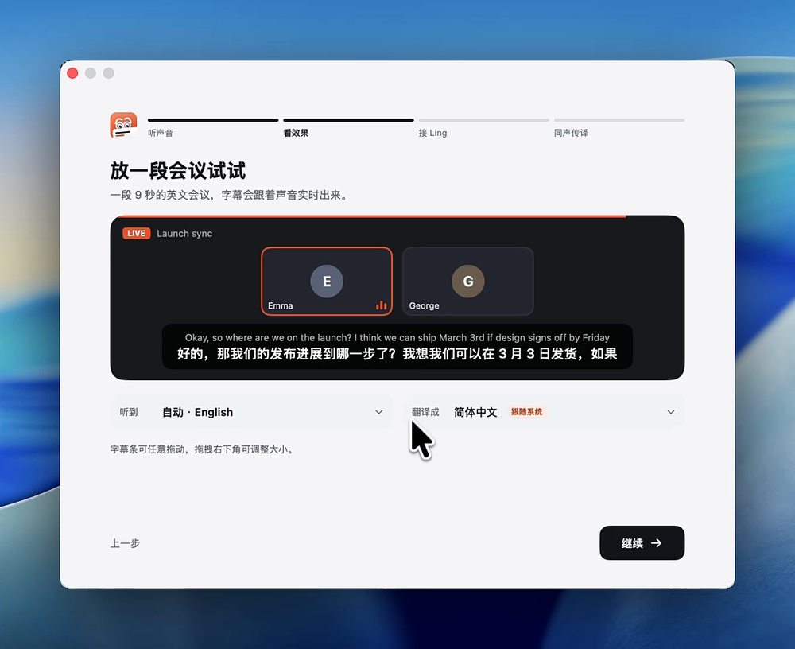

<p align="center">
  
</p>

<h1 align="center">Live Subs</h1>

<p align="center">
  Mac 上正在播放的任何声音，都实时翻译成字幕；你说的话，也能翻译成语音发回会议里。
</p>

<p align="center">
  <a href="https://github.com/wquguru/live-subs/releases/latest"><b>下载 macOS 版</b></a> · <a href="CHANGELOG.md"><b>更新内容</b></a>
</p>

<p align="center">
  
  
  
</p>

<p align="center">
  
</p>

<p align="center"><a href="README.md">English</a> · <a href="README.zh-CN.md">简体中文</a></p>

---

Live Subs 听电脑里正在播放的声音，比如直播、视频、会议或语音房。它先判断说的是哪种语言，再把翻译显示在置顶的小字幕条上。语音识别在本机完成，只有识别出的文字会发去翻译。

## 功能

- **自动识别语言**：所有已安装的本机语音模型同时听同一段声音，最有把握的那个胜出，通常半秒内就能判断出来。
- **翻译成你的语言**：默认跟随系统语言。如果系统是英文、对方说的也是英文，就翻成你的第二首选语言。也可以手动指定。
- **不挡操作**：
  - 有人说话时字幕条才出现，安静后收成一个小点；
  - 鼠标经过时字幕条会变透明，下面的按钮照样能点；
  - 鼠标停住不动，就可以拖动、缩放字幕条；
  - ⌃⌥S 随时隐藏或显示。
- **说话也能翻译**：按住右边的 ⌥ 键说话，会议里的人听到的是翻译后的语音。这需要一个虚拟麦克风，在 App 里一键安装。
- **会议记录**：每场会议都自动存成双语稿子（录音只存在本机），可以导出 Markdown、Word 或 SRT。
- **隐私**：声音采集、语言识别、语音识别都在本机完成。

<p align="center">
  
  &nbsp;
  
</p>

<p align="center">
  
</p>

## 系统要求

- macOS 26，Apple 芯片
- 从源码构建：Xcode Command Line Tools（`xcode-select --install`）

## 安装

1. 从 [Releases](https://github.com/wquguru/live-subs/releases) 下载 **`LiveSubs-<版本>-macOS-AppleSilicon.dmg`**。旁边还有一个 `.zip` 和 `checksums.txt`（SHA-256 校验值）。
2. 打开 DMG，把 **Live Subs** 拖进「应用程序」。
3. 第一次打开会被系统拦住，因为 App 没有经过公证。去 **系统设置 › 隐私与安全性**，点 **仍要打开**。

第一次打开时有三步引导：

1. 打开「听电脑里的声音」，麦克风可选；
2. 播放内置的示例视频，看字幕出来；
3. 如果想让对方听到你的翻译，一键安装虚拟麦克风（只需要输一次电脑密码），装好后自动试音，确认对方听得到。

## 使用

1. 播放任何有声音的内容，字幕会出现在屏幕下方。
2. 点菜单栏图标，可以改“听到”的语言（默认自动识别）、“翻译成”的语言，以及字幕条的显示方式。
3. 想让对方听到你的翻译：
   - 打开 **我说话也翻译**；
   - 在会议软件里把麦克风选成 **BlackHole 2ch**；
   - 说话时按住右边的 ⌥ 键（第一次会请你允许“输入监控”）。两个快捷键都能在设置里换。
4. 面板里的 **会议记录** 可以看所有稿子：能搜索，能切换双语、原文、译文，也能导出。

### 卸载

退出 Live Subs，把它拖进废纸篓即可。会议稿子和录音保存在 `~/Library/Application Support/LiveSubs`，需要的话手动删除。设置可以用 `defaults delete com.wquguru.cicada` 清除。

## 开发

```bash
scripts/build.sh            # 开发版 → build/LiveSubs.app（“Live Subs Dev”，可以和正式版同时运行）
open build/LiveSubs.app
scripts/package.sh          # 正式版 DMG、zip 和校验值
```

架构、开发版和正式版的区别、打包、测试、发布流程，见 [AGENTS.md](AGENTS.md)。
