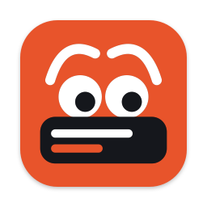
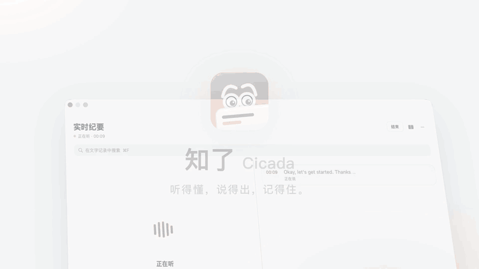
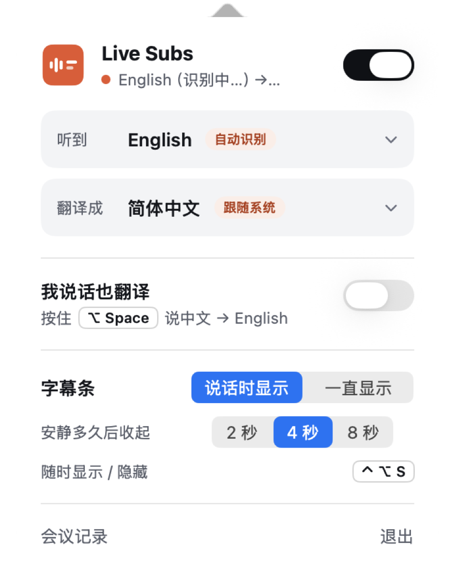
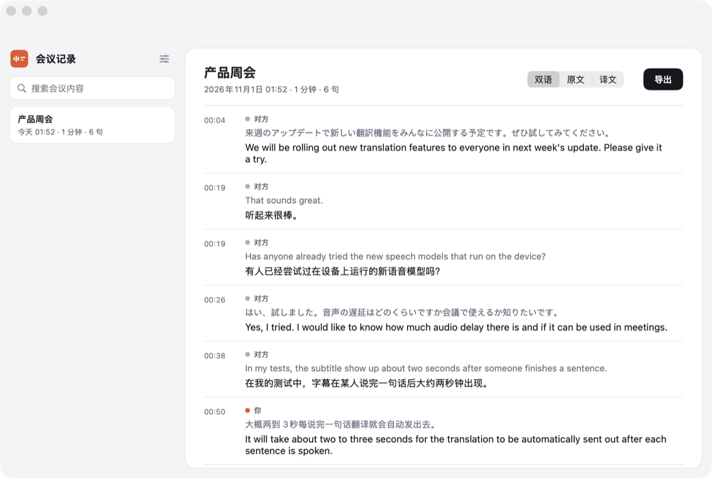

<p align="center">
  
</p>

<h1 align="center">知了 · Cicada</h1>

<p align="center">
  任何会议、任何直播，没有语言障碍。<br>
  听得懂，说得出，记得住。Mac 上的实时纪要、双语文字记录、字幕与同声传译。
</p>

<p align="center">
  <a href="https://cicada.indaloop.app"></a>
  &nbsp;
  <a href="https://github.com/wquguru/cicada/releases/latest"></a>
</p>

<p align="center">
  
  
  
  
</p>

<p align="center"><a href="README.md">English</a> · <a href="README.zh-CN.md">简体中文</a></p>

<p align="center">
  
</p>

知了（Cicada，原名 Live Subs）是一个常驻 Mac 菜单栏的工具，直接听电脑正在播放的声音。开英文产品会时，左边窗口边听边整理中文纪要，右边同步滚动逐句的英中双语文字记录。它不用派机器人进会，对方也不用装任何东西。平时看直播、看视频或者进语音房，你还可以切到轻巧的字幕条，或者按住快捷键说话，让对方直接听到翻译后的语音。

## 主要功能

### 实时纪要与双语文字记录

- **边开会边写纪要**。悬浮窗口大约每 45 秒更新一次，自动整理会议总结、最多 8 个议题与要点、结论、待办、鱼骨图和人名术语表，散会后生成完整版。纪要默认用你的语言（也可以改用会议原文），每条结论和待办都能点一下跳回文字记录里的原话。
- **逐句双语与人名搜索**。右边文字记录把每句话的原文和译文上下排在一起。纪要会统一文中人名和术语的写法并记下听错的写法，按 `⌘F` 搜索时能连同识别错的写法一起搜出来。

### 实时字幕与语言识别

- **本机自动识别语言**。对方开口约 3 秒，已安装的本机语音模型会同时听同一段 3 到 6 秒的声音，最有把握的胜出。语音识别由 Apple SpeechAnalyzer 在本地完成。
- **翻成你的语言与字幕条**。翻译目标默认跟随系统语言，支持双语、只看译文或只看原文。按 `⌃⌥S` 可以在实时纪要窗口、字幕条、不显示之间切换，字幕条只在有人说话时出现，鼠标划过时变透明，不挡底下按钮。

### 同声传译（说话也能翻译）

- **按住快捷键说话**。按住键盘右边的 `⌥` 键开口（可改组合键），对方听到的就是翻译后的语音。声音通过虚拟音频驱动 BlackHole 2ch 传给会议软件，在知了里点一下就能从官方下载安装并自动试音。打开同声传译时知了会把系统麦克风换成它（关掉时换回），Chrome 里的会议网页和用默认麦克风的软件不用再设置；设置里会实时显示哪些会议软件选了它，没选的告诉你怎么改。
- **Ming 人声与声音克隆**。填了 Ling 的 API key 后，由 Ming 语音模型一步听懂并翻译你说的话，大约 2 秒出声。对方听到的声音可以选 Ming 自然人声（英、中、日、韩、德、法、西语）、Mac 自带语音，或用 8 到 30 秒录音克隆自己的声音，不填 key 时使用 Mac 自带语音。

### 会议记录

- **完整保存在本机**。每场会议单独建一个文件夹，存下双语文字记录、纪要和原始录音。说话人目前区分“对方”和“你”，其中“你”只包括按住说话键说的话，在会上直接开口的部分还录不到，对方也还不能细分（见[路线图](#路线图)）。
- **会开完就自动结束**。会议软件挂断，或 10 分钟没人说话时，知了会倒计时结束这场会议，并去掉后面空白的部分，忘了点结束也不会一直记下去。一键可以继续记录，也可以在设置里改。
- **多格式导出**。支持导出成 Markdown、Word（开头就是整理好的纪要）以及 SRT 字幕文件。如果开会时没开实时纪要，会后随时可以点“生成纪要”补一份。

<p align="center">
  
  &nbsp;
  
</p>

## 隐私与权限

声音采集、语言识别、语音识别（Apple SpeechAnalyzer）和会议录音全部在本机完成。会离开电脑的只有识别出来的文字（发去做翻译和生成纪要），以及填了 Ling API key 并按住说话键用同声传译时你说的那几句语音。不填 API key 时，实时字幕、翻译（走 Google 或退回 Apple 本机翻译）、会议记录和同声传译都能正常用。实时纪要、一步语音翻译和声音克隆需要你自己的 Ling（蚂蚁集团的大模型服务）API key（配置方法见[下文](#配置-ling-api-key)），开一小时会大约花 0.15 到 1 元人民币；Ling 每月赠送 10 元额度，约够 10–50 小时会议。

知了只在用到某项功能时才请求对应的权限，拒绝后其他功能照常可用。

| 权限 | 用来做什么 | 什么时候问 | 不给的话 |
|---|---|---|---|
| 录制系统声音（屏幕与系统录音） | 听 Mac 正在播放的声音来出字幕，不录屏幕，也不听知了自己的声音 | 新手引导第一步，或第一次开始听 | 字幕和纪要都用不了 |
| 麦克风 | 只在你按住说话键时录音，用来做同声传译 | 打开同声传译时 | 只是不能说话翻译 |
| 输入监控 | 只用来判断右 `⌥` 是否被单独按下（只监听、不拦截、不记录别的按键） | 第一次用右 `⌥` 说话时 | 在设置里改成 `⌃`/`⌘` 组合键，就不需要这个权限 |
| 管理员密码 | 安装虚拟麦克风 BlackHole 2ch，并重启系统音频服务 | 在引导或设置里点“安装”时，只问一次 | 不能让对方听到翻译，其余照常 |

- **联网与虚拟麦克风**。只有翻译（`translate.googleapis.com`）、填了 key 后的 Ling / Ming（`api.ant-ling.com`）、下载 BlackHole 驱动和每天去 GitHub 检查一次新版本会联网。BlackHole 从官方下载已经过苹果公证的安装包，安装前会核对代码里写死的 SHA-256。
- **没有统计和自建服务器**。应用没有统计、没有埋点，也没有我们自己的服务器，“诊断”功能只把耗时和次数记在本机会议文件夹里。
- **本机数据位置**。会议记录、录音和纪要存在 `~/Library/Application Support/LiveSubs`。Ling key 和你录的声音样本只对当前系统账户可读，不进 Time Machine 备份，也不写进日志和导出文件。
- **共享屏幕看不到纪要窗口**。屏幕共享、录屏和截图都拍不到它；要录演示时可以打开“共享屏幕时让对方看到”。

## 用到的模型

不填 Ling key 时全部由 Apple 本机模型加 Google 翻译完成，填了 key 后由 Ling 和 Ming 模型负责并支持失败自动退回。

| 功能 | 填了 Ling key | 不填 key / 退回 |
|---|---|---|
| 语音识别、语言识别 | Apple `SpeechAnalyzer` / `SpeechTranscriber`（本机） | 同左 |
| 整句翻译 | Ling `Ling-3.1-flash`（可在“设置 › AI 服务”改为 `Ling-3.0-flash`） | Google 翻译 → Apple `Translation`（本机） |
| 正在说的半句话的翻译 | Google 翻译（不占 Ling 的频率额度） | Apple `Translation`（本机） |
| 实时纪要、会后完整版 | Ling `Ling-3.1-flash`（同上设置） | 不可用 |
| 检查 key 是否有效 | Ling `Ling-3.0-tiny`（只用一个 token） | — |
| 同声传译：听懂并翻译你说的话 | Ming `Ming-3.0-audio-flash`，一步完成 | Apple 本机识别，再走上面的翻译链 |
| 同声传译：对方听到的声音、声音克隆 | Ming `Ming-3.0-tts-0.5B` | Mac 自带语音（`AVSpeechSynthesizer`），不能克隆 |
| 说话人识别（实验功能，默认关闭） | WeSpeaker ResNet34-LM 声纹模型，随 app 附带，本机运行（Core ML） | 同左 |

## 配置 Ling API key

1. 打开 [Ling 开放平台](https://chat.ant-ling.com/platform/api)，注册或登录。
2. 点“创建令牌”，复制以 `sk-` 开头的那串 key。
3. 在知了里打开“设置 › AI 服务”，粘贴后点“保存并检查”（也可以直接粘贴到纪要窗口顶部的提示框里）。知了会发一个只用一个 token 的请求确认 key 可用。
4. 同一页面可以选模型（默认 `Ling-3.1-flash`），每种语言用哪个 Ming 声音在“设置 › 同声传译”里选。想移除 key，在同一页面点“移除”即可。

## 系统要求与安装

需要 macOS 26 或更新版本、Apple 芯片的 Mac。

从 [Releases 页面](https://github.com/wquguru/cicada/releases/latest) 或 [官网](https://cicada.indaloop.app) 下载 `Cicada-<版本>-macOS-AppleSilicon.dmg`，打开后把知了拖进“应用程序”。应用目前是本地签名，还没有苹果公证（见[路线图](#路线图)），第一次打开被拦下时，去“系统设置 › 隐私与安全性”点“仍要打开”。下载页同时提供 `checksums.txt`，可以用 `shasum -a 256 Cicada-*.dmg` 核对。有疑问可以去 X 找作者 [@wquguru](https://x.com/wquguru)。

打开后跟着新手引导开一个权限、听一段示例会议、接上 Ling key（也可以先跳过），要用同声传译时再装虚拟麦克风。之后有新版本时菜单栏图标会出现橙点，点一下就能更新，权限不丢。

## 使用方法

界面有中文、英文、日文和韩文，跟随 macOS 的系统语言（也可以在“系统设置 › 通用 › 语言与地区”里单独给知了指定）。

1. 放任何有声音的视频、直播或会议，默认会弹出实时纪要窗口。随时按 `⌃⌥S` 可以在实时纪要窗口、字幕条和不显示之间切换。
2. 点菜单栏上的知了图标，调整听到的语言（默认自动识别）、翻译成的语言以及显示方式。
3. 想用实时纪要，去 [Ling 开放平台](https://chat.ant-ling.com/platform/api) 申请一个 API key，填进“设置 › AI 服务”或纪要窗口的提示框里。
4. 想用同声传译跟对方说话，在菜单栏面板里打开同声传译，按住右边的 `⌥` 键开口。打开期间知了会把系统麦克风换成 BlackHole 2ch；在会议软件里自己选过麦克风的，要在它的音频设置里改成 BlackHole 2ch（或“默认”）。
5. 点面板里的“会议记录”翻看以前的纪要和双语文字记录，支持 `⌘F` 搜索、补生成纪要，或者导出成 Markdown、Word 和 SRT 字幕。

## 路线图

按先后排，想要哪一项欢迎在 Issues 里说。

- **记录我的发言**，开会时持续听麦克风并做回声消除，把你直接开口说的话也记进文字记录和纪要。
- **支持更早的 macOS（14.4 起）**，在旧系统上改用较早的系统语音识别与翻译接口。
- **正式签名与公证**，首次打开不再需要点“仍要打开”，AI key 也能放回系统钥匙串。
- **区分说话人**，把对方里的不同人分开并支持改名，结论和待办标上是谁说的。
- **不用 key 也有纪要**，在支持的 Mac 上用 Apple 本机模型整理纪要，以及**自选 AI 服务**接入其他兼容 OpenAI 接口的服务。
- **声纹识别**，在本机记住常一起开会的人的声音，下次自动认出。
- **Windows 和 Android**，共用纪要与会议记录格式（iPhone / iPad 因系统限制暂不计划）。

每项的细节和取舍见 [docs/ROADMAP.zh-CN.md](docs/ROADMAP.zh-CN.md)。

## 卸载

退出知了，去“应用程序”里把它拖进废纸篓即可。会议记录和录音都在 `~/Library/Application Support/LiveSubs` 文件夹里，不需要的话可以手动删掉。想清除软件设置可以运行：

```bash
defaults delete com.wquguru.cicada
```

## 开发

从源码构建只需要安装 Xcode Command Line Tools（`xcode-select --install`），项目没有任何第三方依赖。

```bash
scripts/build.sh            # 编译开发版 → build/Cicada.app（名为“Cicada Dev”，可与正式版同时运行）
open build/Cicada.app
scripts/package.sh          # 打包正式版 DMG、zip 和 SHA-256 校验值
```

代码架构等说明写在 [AGENTS.md](AGENTS.md) 里。官网源码放在 `site/` 目录，由 `scripts/site.py` 生成。历次更新记录见 [CHANGELOG.md](CHANGELOG.md) 或官网的 [更新日志页](https://cicada.indaloop.app/changelog/)。

## 开源协议

本项目采用 [Apache-2.0](LICENSE) 协议开源。同声传译用到的虚拟麦克风驱动 BlackHole 2ch 采用 GPL 协议，知了安装包里不打包它，而是在你点安装时直接从它的官方发布地址下载。随 app 附带的声纹模型是 [WeSpeaker](https://github.com/wenet-e2e/wespeaker) 在 VoxCeleb 上训练的 ResNet34-LM，采用 CC BY 4.0 协议，由 `scripts/convert-voiceprint.py` 转成 Core ML。
